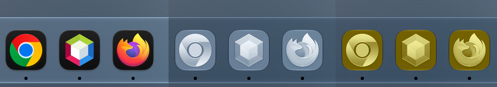

<!--
Licensed to the Apache Software Foundation (ASF) under one
or more contributor license agreements.  See the NOTICE file
distributed with this work for additional information
regarding copyright ownership.  The ASF licenses this file
to you under the Apache License, Version 2.0 (the
"License"); you may not use this file except in compliance
with the License.  You may obtain a copy of the License at

http://www.apache.org/licenses/LICENSE-2.0

Unless required by applicable law or agreed to in writing,
software distributed under the License is distributed on an
"AS IS" BASIS, WITHOUT WARRANTIES OR CONDITIONS OF ANY
KIND, either express or implied.  See the License for the
specific language governing permissions and limitations
under the License.
-->

# Native macOS icon experiment

This opt-in proof of concept investigates
[NetBeans discussion #8671](https://github.com/apache/netbeans/discussions/8671).
It does not change NBPackage's production launcher or packaging defaults.

The existing Swift launcher starts the IDE's shell launcher as a child process.
The IDE then starts Java with `-Xdock:icon`, setting a static ICNS icon. In local
experiments, removing that option produced the default Java icon while the outer
bundle's dark icon appeared briefly on shutdown.

This experiment loads the bundled JDK's `libjli.dylib` in the bundle executable
and invokes `JLI_Launch` in that process. The native launcher retains the app's
bundle identity and supplies no explicit Dock image. On macOS, libjli re-enters
`main` on a worker thread; the launcher must reuse the prepared arguments there
rather than append JVM options a second time.

## Local result and limits

Local testing reported by the contributor:

| System | Result |
| --- | --- |
| Apple Silicon, macOS 27.2.1, NetBeans 31 | IDE remains running with the native icon in Light, Dark, Clear and Tinted appearances. |
| Intel, macOS Sequoia 15.7.2 | IDE works as expected with the legacy static icon. |

The ordinary shell launcher in `Contents/Resources/netbeans/bin/netbeans` was
restored before the original successful test; the in-process launcher bypassed
it. No NetBeans JAR or JDK modifications were needed.

The following composition contains real Dock screenshots on macOS 27.2.1:
colored/dark, clear monochrome, and yellow tinted appearances from left to right.
The updated icon uses 100% foreground opacity in Mono (the `tinted` specialization
in the source), instead of 85%, to keep the lower outline visible.



This demonstrates feasibility, not release readiness. macOS 26 remains untested,
as do other OS/architecture combinations beyond the two reported above.
Compiling with a macOS 11.0 deployment target only removes a binary version
restriction; it does not establish compatibility. The bundled runtime must
itself support the destination OS and architecture. The original ICNS and
`CFBundleIconFile` remain present; the Intel/Sequoia test confirmed the expected
legacy icon appearance on that system.

Changing the launcher affects much more than icons:

- The helper currently supports the IDE's single-line `netbeans_default_options`
  format and bundled JDK layout only. It rejects unexpanded shell expressions.
- JVM options and clusters are snapshotted when preparing the copy. Later config
  edits, user config, alternate JDK selection, and RCP branding are unsupported.
- The native entry point forwards arguments directly to NetBeans. It does not
  implement the shell launcher's `-J`, classpath, or runtime selection switches.
- Updater execution, restart requests, application file/URL events, and
  second-instance behavior require integration work and regression testing.
- A single separate experimental user directory is used. Quit another instance
  of this experiment before launching a new copy.
- Ad hoc signing is sufficient for this local test. Developer ID signing,
  hardened runtime, notarization, and installer integration are unverified.

## Build the icon in GitHub Actions

The **macOS native icon experiment** workflow compiles the source with `actool`
on a macOS 26 runner and uploads `Assets.car`, the generated fallback images,
and the partial plist as `netbeans-icon-catalog`. No compiled catalog is checked
in. Separate macOS 15 ARM and Intel jobs compile the native launcher; those jobs
do not assert GUI startup or icon correctness.

The `netbeans.icon` source is the Icon Composer document supplied in
[the discussion attachment](https://github.com/user-attachments/files/21533584/netbeans.zip),
including the NetBeans logo SVG, with subsequent Mono appearance adjustments.
This is an experimental design, not an adopted
replacement for the shipping logo.

To compile locally with full Xcode and Icon Composer support:

```sh
mkdir -p /tmp/netbeans-icon-build
xcrun actool "$PWD/experiments/macos-native-icons/netbeans.icon" \
  --compile /tmp/netbeans-icon-build \
  --platform macosx --minimum-deployment-target 11.0 \
  --app-icon netbeans --include-all-app-icons \
  --output-partial-info-plist /tmp/netbeans-icon-build/partial.plist
```

Apple documents older-system image generation in
[Creating your app icon using Icon Composer](https://developer.apple.com/documentation/xcode/creating-your-app-icon-using-icon-composer).
Retain the generated outputs for inspection; test the actual fallback behavior
rather than assuming `Assets.car` is ignored by older macOS releases.

## Prepare and launch a disposable copy

Use an existing NBPackage-built IDE `.app` with a bundled JDK. Python 3, Xcode's
C compiler, and `codesign` are needed. Choose a destination that does not exist.
The input app is not modified. The output is ad hoc signed and intended only for
local testing; do not distribute it as a release installer.

```sh
python3 experiments/macos-native-icons/prepare.py \
  '/Applications/Apache NetBeans.app' \
  '/tmp/NetBeans Native Icon Experiment.app' \
  '/tmp/netbeans-icon-build/Assets.car'
open -n '/tmp/NetBeans Native Icon Experiment.app'
```

The helper compiles for the current host architecture. The copied JDK must
match; an ARM JDK cannot validate Intel behavior. Arguments use bundle-relative
placeholders so the resulting test copy can be moved. Logs and a fresh IDE
profile reside under `~/Library/Application Support/NBPackage Native Icon Experiment`.
The launcher does not set a minimum-version plist key on behalf of the runtime.

Before production integration, test at least macOS 15 and 26 on Apple Silicon,
additional Intel/older-system combinations, all Tahoe icon appearances, argument and
configuration handling, restarts, updates, file opening, and release signing.
